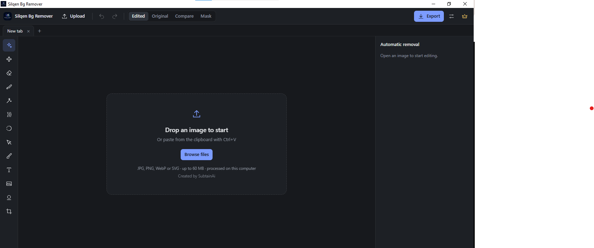

# SILQEN BG REMOVER

**An AI background remover and photo editor for Windows that runs entirely on your computer.** Your images are never uploaded anywhere.



## Features

**AI background removal**
- One-click background removal with three AI models: **Fast**, **Balanced** and **Best**
- Runs offline. Internet is only needed once, to download a model the first time it is used.

**Touch-up tools**
- Eraser, Restore brush and Magic brush (colour-aware)
- Hair refinement and Edge refinement (feather / shift edge)
- Object selection (click to remove or keep a colour region)

**Design tools**
- **Move & resize** the subject like in Canva: drag, resize from the corners, rotate (Shift snaps to 15°)
- **Paint brush** on its own layer, so erasing paint never touches the photo
- **Text** with 10 fonts, colour, bold/italic, alignment, opacity, rotation and outline
- Backgrounds: colour, gradient, image or blurred original
- Drop shadow and crop
- Hex and RGB colour input everywhere

**Workflow**
- **Tabs** like Photoshop: work on several images at once (Ctrl+T, Ctrl+W, Ctrl+Tab)
- Undo / redo for every edit
- Preview modes: Edited, Original, Compare and Mask

**Import and export**
- Open JPG, PNG, WebP and **SVG**
- Export PNG, JPG, WebP, TIFF and SVG, at the original size or a custom size
- SVG logos stay sharp: unedited SVGs are saved as real vectors at any size, and larger PNG/JPG exports are re-rendered from the vector source

## Download

Get the Windows installer from the [**Releases**](../../releases) page. The installer includes all three AI models, so the app works offline straight away.

## Run from source

Requirements: Windows 10/11 and **Python 3.13**.

```
pip install -r requirements.txt
python app.py
```

Models are not included in this repository because of their size. The app downloads each model automatically the first time it is used.

## Build the installer

1. Put the model files (`u2netp.onnx`, `isnet-general-use.onnx`, `birefnet-general.onnx`) in the `models` folder.
2. Put your logo as `web\logo.png`, then create the icon:
   ```
   python make_icon.py
   ```
3. Build the app:
   ```
   python -m PyInstaller --noconfirm --windowed --name "SILQEN BG REMOVER" --icon icon.ico --collect-all rembg --collect-all onnxruntime --collect-all pymatting --collect-all webview --recursive-copy-metadata rembg --add-data "web;web" --add-data "models;models" app.py
   ```
4. Open `setup.iss` in [Inno Setup](https://jrsoftware.org/isinfo.php) and choose **Build > Compile**.

## Keyboard shortcuts

| Action | Keys |
|---|---|
| Undo / Redo | Ctrl+Z / Ctrl+Shift+Z |
| New tab / Close tab / Next tab | Ctrl+T / Ctrl+W / Ctrl+Tab |
| Zoom in / out, Fit, 100% | + / -, 0, 1 |
| Pan | Space + drag |
| Toggle original | O |
| Brush size | [ / ] |
| Move, Eraser, Restore, Magic, Hair | V, E, R, M, H |
| Select, Paint, Text, Background, Crop | S, P, T, B, C |

## Project structure

```
app.py          Local server, AI engine (rembg) and the app window (pywebview)
web/            Editor interface (index.html, style.css, editor.js)
models/         AI model files (not in the repository)
make_icon.py    Creates icon.ico from web/logo.png
setup.iss       Inno Setup installer script
```

## How it works

`app.py` starts a small local server on `127.0.0.1` and opens the editor in its own window using pywebview. The editor sends a resized copy of the image to the local AI model, gets back only the mask, and applies it to the full-resolution image. Nothing leaves the computer.

## Credits

- [rembg](https://github.com/danielgatis/rembg) for background removal
- [U²-Net](https://github.com/xuebinqin/U-2-Net) (Fast model)
- [DIS / IS-Net](https://github.com/xuebinqin/DIS) (Balanced model)
- [BiRefNet](https://github.com/ZhengPeng7/BiRefNet) (Best model)
- [pywebview](https://github.com/r0x0r/pywebview) for the app window

Each of these projects has its own license. Please check them before using this app commercially.

## Author

Created by **SubtainAi**
